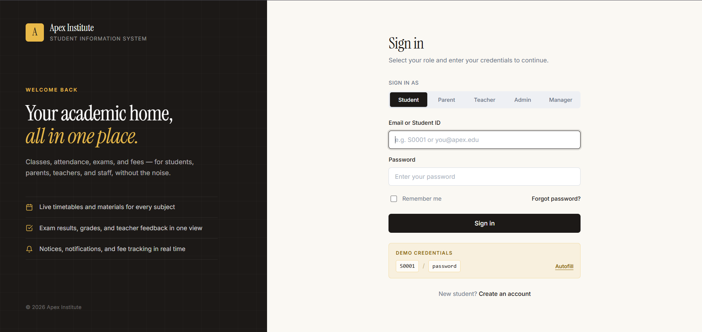
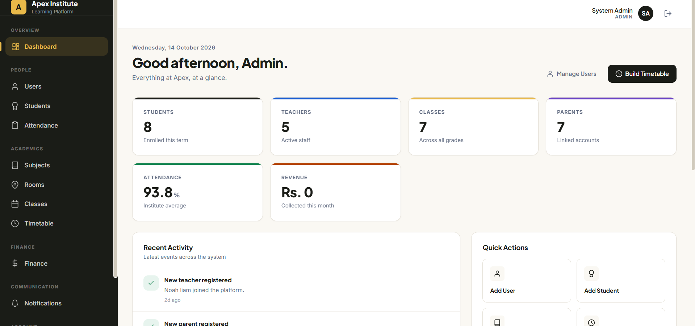
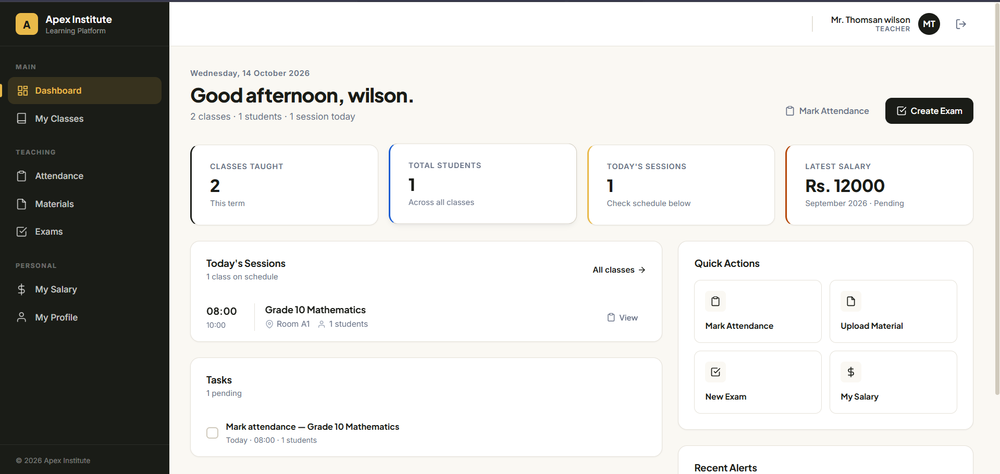
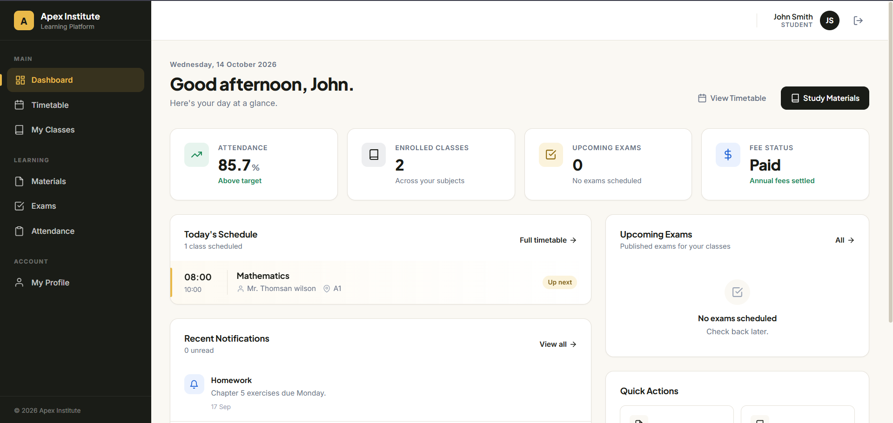
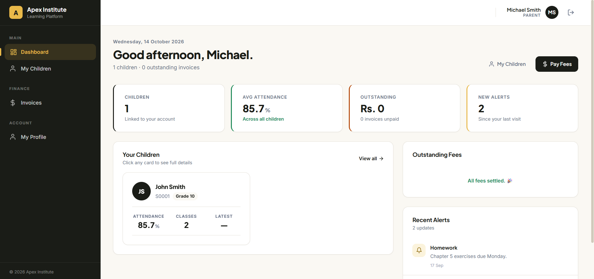
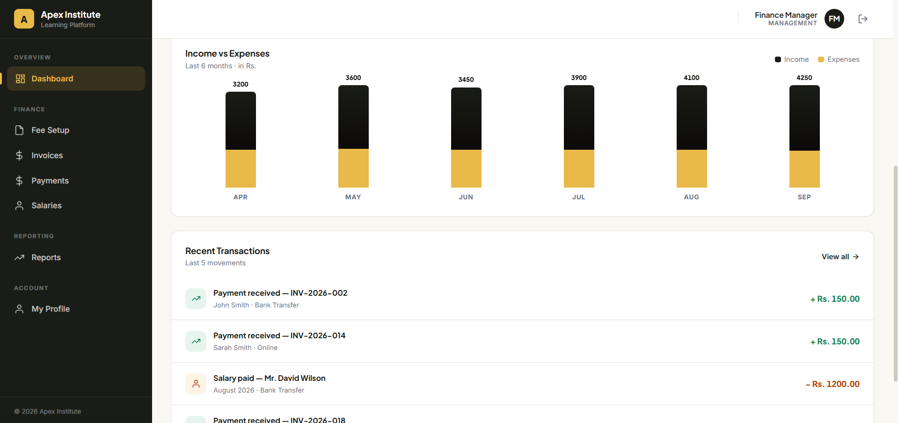
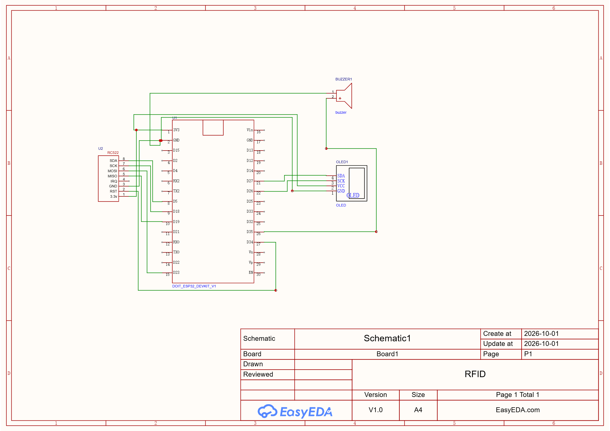

# Apex Institute — Web-Based Education Institute Management System

A full-stack Spring Boot application for managing a modern education institute. It provides role-based dashboards for **Admin, Teacher, Student, Parent, and Management**, along with attendance (including RFID), exams, marks, fees, invoices, payments, salaries, notifications, learning materials, and timetables.


---

##  Table of Contents

- [Overview](#-overview)
- [Features](#-features)
- [Tech Stack](#-tech-stack)
- [Architecture](#-architecture)
- [Project Structure](#-project-structure)
- [Getting Started](#-getting-started)
- [Configuration](#-configuration)
- [Running the Application](#-running-the-application)
- [API Overview](#-api-overview)
- [Screenshots](#-screenshots)
- [Roadmap](#-roadmap)
- [Contributing](#-contributing)
- [License](#-license)
- [Author](#-author)

---

## Overview

**Apex Institute** is a role-based institute management system that unifies academic, financial, and administrative workflows in a single web platform.

The application is designed using **Spring Boot**, **Spring Security with JWT**, **Spring Data JPA**, and a **REST API** consumed by a web frontend.

The system supports the following actors:

| Role | Responsibilities |
|---|---|
| **Admin** | Manage users, classes, subjects, rooms, timetables, and notifications |
| **Management** | Manage fees, invoices, payments, salaries, reports, and dashboards |
| **Teacher** | Manage classes, attendance, exams, marks, materials, and salary information |
| **Student** | View timetables, attendance, exams, marks, materials, and classes |
| **Parent** | Monitor children, attendance, grades, invoices, and payments |
| **RFID Device** | Submit card scans through a dedicated attendance endpoint |

---

##  Features

### Authentication & Security

- JWT-based authentication and authorization
- Role-based access control for Admin, Management, Teacher, Student, and Parent
- Custom `UserDetailsService` and `JwtAuthFilter`
- Password change functionality
- Profile management
- Protected REST API endpoints

###  Admin Dashboard

- Dashboard with KPIs, recent activities, and announcements
- User and student management
- Class and subject management
- Room management
- Timetable builder with conflict detection
- Notification management
- Attendance roster and reporting

###  Management Dashboard

- Financial dashboard with monthly income and expense charts
- Fee structures by grade
- Invoice creation and tracking
- Payment recording for cash, card, bank, and online payments
- Teacher salary management
- Financial reports, including:
  - Outstanding payments and defaulters
  - Income by grade
  - Payment method breakdown

###  Teacher Dashboard

- Personal dashboard with sessions, tasks, and salary overview
- Class lists and student rosters
- Attendance management by class and session
- Exam creation and management
- Question management
- Marks entry and publication
- Course material uploads and management

### Student Dashboard

- Personalized dashboard with schedules, exams, and notifications
- Timetable viewing
- Attendance history and subject-wise breakdown
- Available online examinations
- Online exam submission
- Grades and examination results
- Study materials organized by subject

### Parent Dashboard

- Multi-child dashboard
- Child-specific academic information
- Attendance monitoring
- Grades and examination results
- Timetable and examination information
- Invoice management
- Online payment functionality
- Notifications and alerts

### 📡 RFID Attendance System

- Dedicated endpoint for RFID card scans
- Automatic attendance marking
- RFID card issuance and student mapping
- Integration-ready attendance workflow

---

## 🛠 Tech Stack

| Layer | Technology |
|---|---|
| Programming Language | Java 17+ |
| Backend Framework | Spring Boot 3.x |
| Security | Spring Security, JWT |
| Persistence | Spring Data JPA, Hibernate |
| Build Tool | Maven |
| Database | MySQL 8+ or PostgreSQL 14+ |
| API Architecture | REST API |
| Data Transfer | DTO pattern |
| File Storage | Local `uploads/` directory |
| Testing | JUnit 5, Spring Boot Test |
| Version Control | Git and GitHub |

---

## 🏛 Architecture

The application follows a layered architecture that separates HTTP handling, business logic, data access, and persistence.

```text
                  Web / Mobile Client
                          |
                          v
                     Controllers
                          |
                          v
                       Services
                          |
                          v
                     Repositories
                          |
                          v
                       Database

             Supporting Components
             ---------------------
             DTOs
             JPA Entities
             Spring Security
             JWT Authentication
             Configuration
```

### Architecture Components

- **Controllers** — Handle HTTP requests, responses, and request validation.
- **Services** — Implement business logic and transaction management.
- **Repositories** — Provide database access through Spring Data JPA.
- **Entities** — Represent database tables using JPA mappings.
- **DTOs** — Define request and response structures independently of database entities.
- **Security** — Handles JWT authentication, user details, and role-based authorization.
- **Configuration** — Manages application settings, CORS, security rules, and static resources.

See `docs/class-diagram.png` for the domain model, if available in the repository.

---

## 📂 Project Structure

```text
ApexInstitute/
├── .github/
│   └── workflows/                 # CI/CD workflows
├── .mvn/
│   └── wrapper/                   # Maven Wrapper files
├── docs/
│   ├── class-diagram.png
│   └── screenshots/
├── src/
│   ├── main/
│   │   ├── java/
│   │   │   └── com/
│   │   │       └── apexinstitute/
│   │   │           ├── ApexInstituteApplication.java
│   │   │           ├── config/
│   │   │           ├── controller/
│   │   │           ├── dto/
│   │   │           ├── entity/
│   │   │           ├── repository/
│   │   │           ├── security/
│   │   │           └── service/
│   │   └── resources/
│   │       └── application.properties.example
│   └── test/
│       └── java/
├── uploads/                       # Runtime uploads (gitignored)
├── .gitattributes
├── .gitignore
├── LICENSE
├── README.md
├── mvnw
├── mvnw.cmd
└── pom.xml
```

---

##  Getting Started 

### Prerequisites

Install the following tools before running the application:

- **JDK 17 or later** — [Download OpenJDK](https://adoptium.net/)
- **Maven 3.9+** — Optional if using the included Maven Wrapper
- **MySQL 8+** or **PostgreSQL 14+**
- **Git** — [Download Git](https://git-scm.com/)

Verify your installations:

```bash
java -version
git --version
```

On Linux or macOS:

```bash
./mvnw -version
```

On Windows:

```powershell
.\mvnw.cmd -version
```

### Clone the Repository

Replace the placeholder with your actual GitHub repository URL.

```bash
git clone https://github.com/YOUR_USERNAME/ApexInstitute.git
cd ApexInstitute
```

---

## ⚙️ Configuration

### 1. Create the Configuration File

Copy the example configuration file.

**Windows PowerShell:**

```powershell
Copy-Item src\main\resources\application.properties.example src\main\resources\application.properties
```

**Linux / macOS:**

```bash
cp src/main/resources/application.properties.example src/main/resources/application.properties
```

### 2. Configure the Database

Example configuration for MySQL:

```properties
spring.datasource.url=jdbc:mysql://localhost:3306/apex_institute
spring.datasource.username=${DB_USERNAME}
spring.datasource.password=${DB_PASSWORD}

spring.jpa.hibernate.ddl-auto=update
spring.jpa.show-sql=false

jwt.secret=${JWT_SECRET}
jwt.expiration=86400000

server.port=8080
uploads.dir=./uploads
```

Adjust the properties to match your database, security implementation, and environment.

### 3. Create the Database

For MySQL, execute:

```sql
CREATE DATABASE apex_institute
CHARACTER SET utf8mb4
COLLATE utf8mb4_unicode_ci;
```

### 4. Set Environment Variables

Set the database credentials and JWT secret using your operating system or IDE run configuration.

Never commit real database passwords, JWT secrets, API keys, or other sensitive credentials to GitHub.

> **Note:** The configuration above is an example. Ensure the corresponding properties are supported by your application's implementation before running it.

---

## Running the Application

### Start in Development Mode

**Windows:**

```powershell
.\mvnw.cmd spring-boot:run
```

**Linux / macOS:**

```bash
./mvnw spring-boot:run
```

When the application starts successfully, access it at:

http://localhost:8080

### Build the Application

**Windows:**

```powershell
.\mvnw.cmd clean package
```

**Linux / macOS:**

```bash
./mvnw clean package
```

### Run the Executable JAR

After building the project:

```bash
java -jar target/ApexInstitute-0.0.1-SNAPSHOT.jar
```

Replace the example JAR filename with the actual filename generated inside `target/`.

### Run Tests

**Windows:**

```powershell
.\mvnw.cmd test
```

**Linux / macOS:**

```bash
./mvnw test
```

---

## 🔌 API Overview

The API uses the `/api` base path. Protected endpoints use Bearer JWT authentication.

| API Group | Base Path | Description |
|---|---|---|
| Authentication | `/api/auth` | Login, registration, and password changes |
| Users | `/api/users` | User profiles and profile updates |
| Admin | `/api/admin` | Users, students, classes, subjects, rooms, timetables, notifications, and attendance |
| Management | `/api/management` | Fees, invoices, payments, salaries, and financial reports |
| Teacher | `/api/teacher` | Classes, attendance, exams, marks, materials, and salary information |
| Student | `/api/student` | Timetables, attendance, exams, marks, materials, and classes |
| Parent | `/api/parent` | Children, attendance, invoices, and payments |
| RFID | `/api/rfid` | RFID card scans and attendance |
| Notifications | `/api/notifications` | Notification listing and read status |

> The endpoint paths above describe the intended API organization. Confirm individual routes against the implemented controllers.

### Example: Login

```bash
curl -X POST http://localhost:8080/api/auth/login \
  -H "Content-Type: application/json" \
  -d '{"username":"admin","password":"YOUR_PASSWORD"}'
```

Example response format:

```json
{
  "token": "YOUR_JWT_TOKEN",
  "role": "ADMIN",
  "username": "admin"
}
```

The actual response fields depend on your authentication controller.

### Example: Access a Protected Endpoint

```bash
curl http://localhost:8080/api/admin/dashboard \
  -H "Authorization: Bearer YOUR_JWT_TOKEN"
```

---

## 🖼 Screenshots

Add application screenshots to `docs/screenshots/` and update the image paths below.

| Login Page | Admin Dashboard |
|---|---|
|  |  |

| Teacher Dashboard | Student Dashboard |
|---|---|
|  |  |

| Parent Dashboard | Management Reports |
|---|---|
|  |  |

| Schematic Diagram | IOT Device |
|---|---|
|  |   |
---


## 🤝 Contributing

Contributions, suggestions, and bug reports are welcome.


---

## 📜 License

This project is licensed under the MIT License. See the `LICENSE` file for details.

---

## 👤 Author

**Sadaham Vishwanath**

- GitHub: [@sadahamvishwanath](https://github.com/sadahamvishwanath)
- Email: your.email@example.com
- LinkedIn: [Your LinkedIn Profile](https://www.linkedin.com/in/sadaham-vishwanath/)

